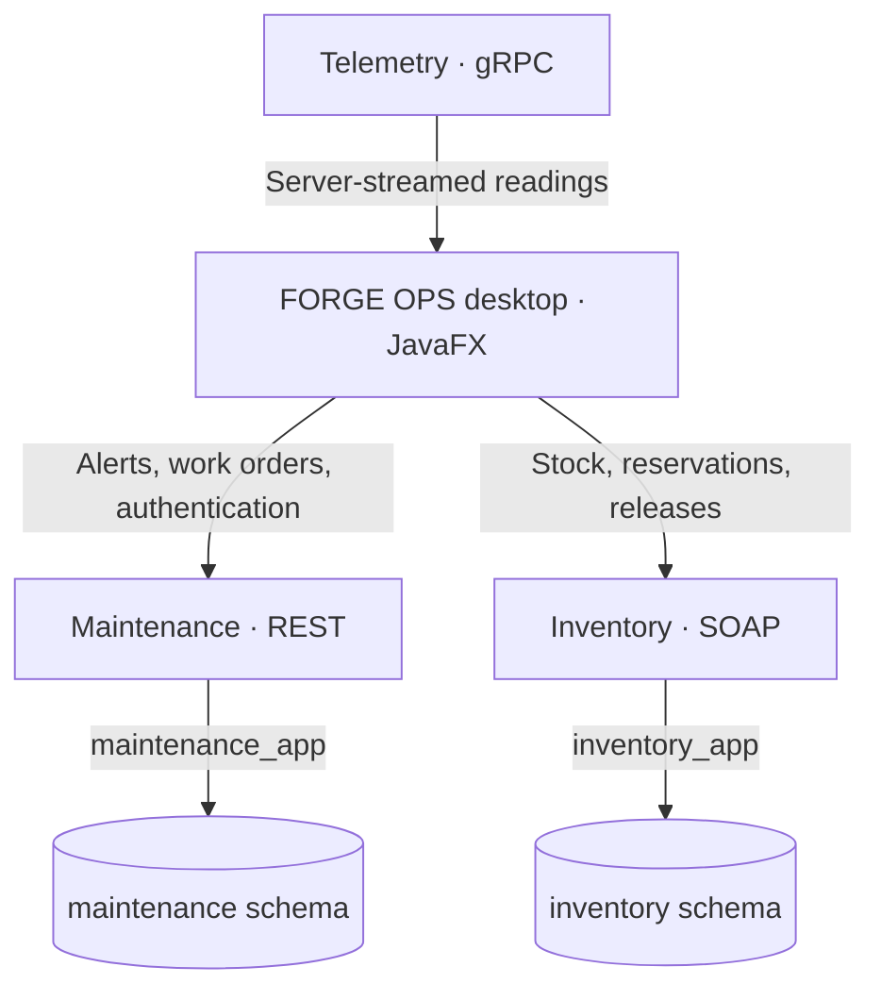

# Kestrel

**Industrial maintenance command center built with Java 21, JavaFX, and three service protocols.**

Kestrel turns simulated machine telemetry into maintenance work orders. The **FORGE OPS** desktop shows live readings, detects critical signals, and lets an operator follow a spare-part reservation from stock check through confirmation. When a service becomes unavailable, the desktop retains the information needed to continue the workflow.

[Run on Fedora](#run-on-fedora) · [See the service architecture](#architecture) · [Run the tests](#verification) · [Rehearse the demo](docs/kestrel-release.md#five-minute-jury-walkthrough)

## FORGE OPS desktop

- **Command Deck** shows the selected machine and a one-minute trend for temperature, vibration, pressure, and energy. The graphs use actual simulator readings and leave gaps when samples stop.
- **Live Telemetry** streams machine data over gRPC. Freshness and connection status are visible independently.
- **Alerts, Work Orders, and Inventory** give operators access to the records, stock checks, and workflow actions for their role.
- **Orchestration** shows the current step, the outcome of each protocol call, and the action to continue a pending operation.
- **Settings** lets an operator change the simulation profile and enable **Reduce motion**. The horizontal tabs support keyboard navigation.

## Architecture



| Module | Responsibility | Local endpoint |
| --- | --- | --- |
| [Maintenance](maintenance-service/README.md) | Machine registry, alerts, work-order transitions, and JWT issuance | [Swagger UI · 8081](http://127.0.0.1:8081/swagger-ui/index.html) |
| [Inventory](inventory-service/README.md) | Contract-first SOAP operations and transactional stock updates | [WSDL · 8082](http://127.0.0.1:8082/services/inventory?wsdl) |
| [Telemetry](telemetry-service/README.md) | Machine snapshots, simulator controls, and live gRPC streams | `127.0.0.1:9090` |
| [Desktop](desktop-client/README.md) | JavaFX operator interface and coordination across the services | Local application |

Maintenance and Inventory use separate schemas and database roles in PostgreSQL. Flyway manages each service's migrations. Maintenance issues RS256 access tokens, and Inventory and Telemetry validate those tokens and enforce role permissions. Demo passwords are stored as BCrypt hashes.

**Identifiers.** REST resources use UUIDs. gRPC and alert deduplication use `machineCode`, such as `MACHINE-001`. Alert and work-order DTOs carry both the machine UUID and its code. See the [canonical ID convention](contracts/identifiers.md) and the [API contracts](contracts/README.md).

### Reservation recovery

The desktop checks stock, requests a reservation through SOAP, and attaches the confirmed reservation UUID to the REST work order. A retry with the original SOAP `requestId` returns the existing reservation. When SOAP has confirmed the reservation and only the REST link is pending, the desktop resumes linking with the saved reservation UUID.

| Scenario | Result |
| --- | --- |
| Normal telemetry | Live readings appear on the Command Deck |
| Critical machine reading and stock available | An alert and work order lead to a confirmed reservation and `READY_FOR_MAINTENANCE` |
| Insufficient stock | The work order moves to `WAITING_FOR_PARTS` |
| Inventory temporarily unavailable | The work order moves to `PENDING_RESERVATION` and the operator can retry |
| Maintenance unavailable after SOAP confirmation | The operator can resume linking the original reservation UUID |

The [workflow sequence diagram](docs/kestrel-release.md#workflow-sequence) and [five-minute walkthrough](docs/kestrel-release.md#five-minute-jury-walkthrough) cover these paths in the running app.

## Run on Fedora

**Prerequisites:** JDK 21, Docker Engine with Compose, Git, Python 3.9 or newer, and a graphical desktop session. The Maven Wrapper supplies Maven. Install `grpcurl` for the live end-to-end check. Packaging requires a full JDK 21 with `jpackage` and `jmods`.

From the repository root, create your local configuration:

```bash
if [ ! -e .env ]; then
  (umask 077 && cp .env.example .env)
fi
${EDITOR:-nano} .env
```

Set distinct values for `POSTGRES_PASSWORD`, `MAINTENANCE_DB_PASSWORD`, and `INVENTORY_DB_PASSWORD`. To enable the desktop demo sign-in, uncomment and set all four `KESTREL_DEMO_*_PASSWORD` entries. Use simple alphanumeric values of at least 12 characters and at most 72 bytes. If port `5432` is occupied, set `POSTGRES_PORT=55432` in `.env`. For an existing database volume, keep the database credentials that were used to initialize it.

Start Docker, then run:

```bash
./scripts/run-all.sh all
```

The launcher builds the modules, generates the local signing keys on first use, starts PostgreSQL, and launches the services and desktop. Sign in as `admin` with the demo admin password you set.

On a fresh database, register a simulator machine before running an alert or reservation demo. Open Swagger UI, call `POST /auth/login`, authorize with the returned access token, and call `POST /machines` with:

```json
{
  "machineCode": "MACHINE-001",
  "name": "Press 01",
  "location": "Demo Workshop",
  "model": "Kestrel Simulator"
}
```

If your services are already running, launch only the desktop with `./scripts/run-all.sh desktop`. Use [the separate-terminal setup](docs/kestrel-demo.md#startup) for demos that restart a service mid-workflow. Local configuration and signing keys are kept out of Git.

## Verification

```bash
# Maven tests, isolated PostgreSQL integration tests, and UI freshness checks
./scripts/phase9-smoke-test.sh

# End-to-end check against the running stack
./scripts/phase9-smoke-test.sh --live --machine-code MACHINE-001
```

The first command runs the Maintenance, Inventory, and Telemetry suites, followed by the desktop freshness check. The live command prompts for the admin password and requires an online, registered machine and at least one demo bearing. It verifies that a repeated reserve deducts stock once, links the reservation in REST, and verifies that a repeated release restores stock once. It leaves a cancelled test work order and its audit history in the demo database.

The Fedora verification run passed **20 Maven tests**, the desktop freshness check, and the live REST/SOAP/gRPC reservation check.

## Package the desktop

```bash
./scripts/package-desktop.sh
```

Open the `Launch:` path printed under `target/distribution/`. Copy the entire generated `Kestrel` directory when moving the app image. It bundles the desktop client and Java 21 runtime. Start the backends separately with `./scripts/run-all.sh backend`. See the [packaging and acceptance checklist](docs/kestrel-release.md).

## Project guide

| Start here | You will find |
| --- | --- |
| [API contracts](contracts/README.md) | OpenAPI, WSDL/XSD, Protobuf, and shared conventions |
| [Desktop guide](desktop-client/README.md) | Launch modes and local workflow recovery |
| [FORGE OPS top bar](docs/forge-ops-topbar.md) and [signal graphics](docs/forge-ops-comfort.md) | Navigation, motion, palette, and live plots |
| [Jury rehearsal](docs/kestrel-release.md) | Architecture and workflow references, five-minute script, and Q&A |

Developed by **Rahmouni Oussema**, **Mosbeh Houssem**, and **Hajlaoui Amal** as an academic Service-Oriented Architecture project.
