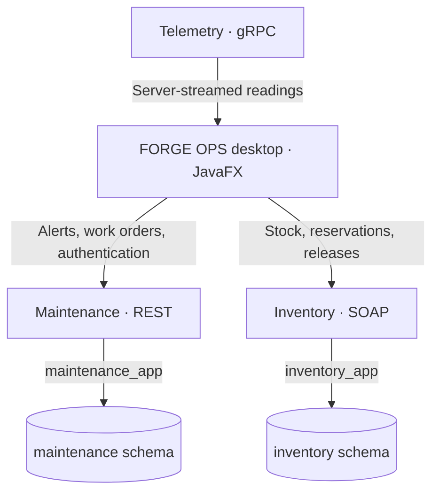
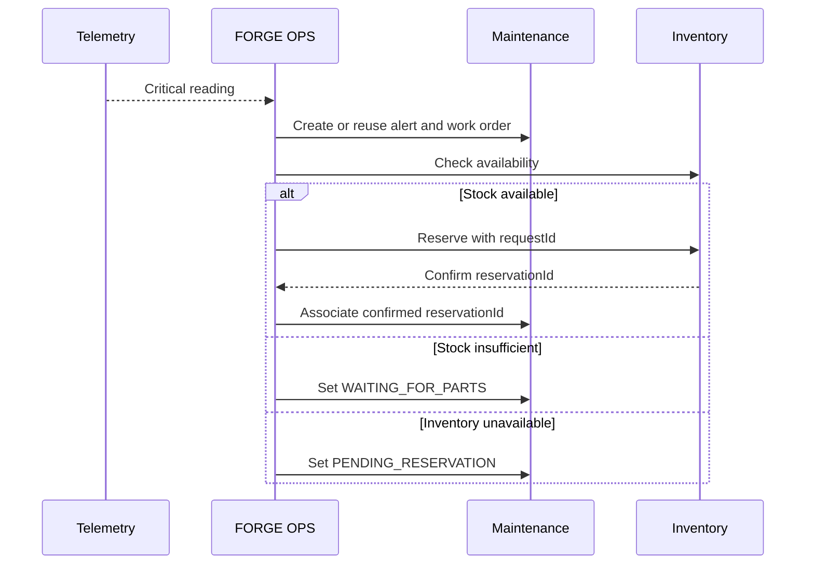

# Kestrel

**Industrial maintenance command center built with Java 21, JavaFX, REST, SOAP, and gRPC.**

Kestrel turns simulated machine telemetry into maintenance alerts and work orders. The **FORGE OPS** desktop lets an operator monitor live readings, check spare-part availability, and follow a reservation through confirmation and association with a work order. If a service goes offline, the operator can resume the saved workflow after it comes back.

[Run on Linux](#run-on-linux) · [Operator walkthrough](#operator-walkthrough) · [Architecture](#architecture) · [Testing](#testing) · [Desktop packaging](#desktop-packaging) · [Troubleshooting](#troubleshooting)

## FORGE OPS desktop

| Screen | What you can do |
| --- | --- |
| **Command Deck** | Check the selected machine, current readings, one-minute signal trends, Maintenance registry, and alert feed. |
| **Live Telemetry** | Watch temperature, vibration, pressure, and power update over gRPC. Reading freshness and service connectivity have separate indicators. |
| **Alerts** | Review alerts by machine, metric, and status. Authorized operators can acknowledge or resolve them. |
| **Work Orders** | Review or create orders, inspect part requirements and reservation references, assign technicians, and apply permitted status transitions. |
| **Inventory** | Look up a spare part by UUID and check its available quantity. |
| **Orchestration** | Arm a machine, follow the alert and reservation timeline, and continue a saved run. |
| **Settings** | Change the selected machine’s simulation scenario and enable **Reduce motion**. |

The desktop uses a horizontal navigation bar, keyboard-accessible tabs, and a persistent protocol status rail. The sparklines use the selected machine’s actual simulated readings. Gaps remain visible when samples stop arriving.

## Architecture



| Module | Responsibility | Default local endpoint |
| --- | --- | --- |
| [Maintenance](maintenance-service/README.md) | Machine registry, alerts, work-order transitions, technician assignments, and JWT issuance | [Swagger UI · 8081](http://127.0.0.1:8081/swagger-ui/index.html) |
| [Inventory](inventory-service/README.md) | Contract-first SOAP operations and transactional stock updates | [WSDL · 8082](http://127.0.0.1:8082/services/inventory?wsdl) |
| [Telemetry](telemetry-service/README.md) | Machine snapshots, simulation controls, and continuous gRPC streams | `127.0.0.1:9090` |
| [Desktop](desktop-client/README.md) | JavaFX operator interface and orchestration across the services | Local application |
| PostgreSQL | Separate Maintenance and Inventory schemas in a shared database | `127.0.0.1:5432` by default, configurable with `POSTGRES_PORT` |

Kestrel uses Java 21, JavaFX, Spring Boot, Apache CXF, gRPC/Protobuf, PostgreSQL, Flyway, Maven, and Docker Compose. Each persistence service manages its own schema migrations and connects with its own database role. The telemetry simulator keeps its latest readings in memory.

### Contracts and identifiers

- [REST OpenAPI](contracts/api/maintenance.openapi.yaml)
- [Inventory WSDL](contracts/soap/inventory.wsdl) and [XML schema](contracts/soap/inventory.xsd)
- [Telemetry Protobuf](contracts/grpc/telemetry.proto) and [simulation controls](contracts/grpc/simulation_control.proto)

| Identifier | How it is used |
| --- | --- |
| REST UUID | Identifies a resource such as a machine, alert, work order, or technician. |
| `machineCode` | Identifies the machine in gRPC. Maintenance uses this code with the metric type to deduplicate active alerts. |
| `machineId` | Identifies the registered machine by UUID. Alert and work-order DTOs carry both `machineId` and `machineCode`. |
| SOAP `requestId` | Identifies one reservation attempt. The client reuses it when the outcome is uncertain. |
| `reservationId` | Identifies Inventory’s confirmed reservation and the reference attached to the REST work order. |

See the [canonical ID convention](contracts/identifiers.md) and [shared API behavior](contracts/README.md).

### Access and data ownership

Maintenance issues RS256 access tokens. Each service validates the token and applies role permissions. Demo account passwords are hashed with BCrypt. Maintenance and Inventory write to their own PostgreSQL schemas, and cross-service references travel through the published contracts.

| Demo sign-in | Role | Typical use |
| --- | --- | --- |
| `admin` | `ADMIN` | Register machines and demonstrate the full workflow. |
| `maintenance` | `MAINTENANCE_OPERATOR` | Work with alerts, work orders, and reservations. |
| `technician` | `TECHNICIAN` | Review assigned work orders and start or complete them. |
| `inventory` | `INVENTORY_OPERATOR` | Look up parts and perform authorized inventory operations through SOAP. |

## Run on Linux

Use **JDK 21**, Git, Python 3.9 or later, Docker Engine with Docker Compose, and a graphical desktop session for JavaFX. The Maven Wrapper supplies Maven. Install `grpcurl` to run the live integration check. Desktop packaging requires a full JDK 21 installation with `jpackage` and `jmods`.

If you need a fresh checkout:

```bash
git clone https://github.com/Oussema-gif/KESTREL.git
cd KESTREL
```

Run the remaining commands from the repository root. Check the required tools:

```bash
java -version
docker compose version
docker info
python3 --version
```

Start your Docker daemon if `docker info` cannot connect. On a systemd installation, use `sudo systemctl start docker`.

### Configure the local environment

```bash
if [ ! -e .env ]; then
  (umask 077 && cp .env.example .env)
fi
"${EDITOR:-nano}" .env
```

| Setting | Value to configure |
| --- | --- |
| `POSTGRES_PASSWORD` | Local PostgreSQL bootstrap password |
| `MAINTENANCE_DB_PASSWORD` | Password for `maintenance_app` |
| `INVENTORY_DB_PASSWORD` | Password for `inventory_app` |
| `KESTREL_DEMO_ADMIN_PASSWORD` | Password for the `admin` demo account |
| `KESTREL_DEMO_MAINTENANCE_PASSWORD` | Password for the `maintenance` demo account |
| `KESTREL_DEMO_TECHNICIAN_PASSWORD` | Password for the `technician` demo account |
| `KESTREL_DEMO_INVENTORY_PASSWORD` | Password for the `inventory` demo account |

Set distinct local passwords. To enable demo sign-in, uncomment and set all four demo entries. Simple alphanumeric demo passwords work with both Compose and the Java properties reader. Each demo password needs at least 12 characters and at most 72 bytes. For an existing database volume, reuse the database credentials that initialized it. If port `5432` is occupied, select a free port with `POSTGRES_PORT`, for example `55432`. Keep `.env` and `.kestrel/keys/` local.

### Start the stack

```bash
./scripts/run-all.sh all
```

The launcher builds the modules, generates signing keys on first use, starts PostgreSQL, and waits for Maintenance, Inventory, and Telemetry before opening the desktop. Sign in as `admin` with the demo admin password you configured.

| Launch mode | Command |
| --- | --- |
| Services and desktop | `./scripts/run-all.sh all` |
| Services only, for a packaged or separately launched client | `./scripts/run-all.sh backend` |
| Desktop with the services already running | `./scripts/run-all.sh desktop` |
| Build and prepare PostgreSQL for separate service terminals | `./scripts/run-all.sh prepare` |
| Start individual services after preparation | `./scripts/run-all.sh maintenance`, `./scripts/run-all.sh inventory`, or `./scripts/run-all.sh telemetry` |

The combined launcher writes service logs to `.kestrel/logs/`. Press **Ctrl+C** in its terminal to stop those processes. To stop PostgreSQL while keeping its data, use `docker compose stop postgres`.

## Operator walkthrough

### 1. Register and select a machine

The simulator provides `MACHINE-001`, `MACHINE-002`, and `MACHINE-003` by default. Register each machine you want to use for alerts and work orders in Maintenance. On a fresh database, open [Swagger UI](http://127.0.0.1:8081/swagger-ui/index.html), call `POST /auth/login`, authorize with the returned `accessToken`, and call `POST /machines`:

```json
{
  "machineCode": "MACHINE-001",
  "name": "Press 01",
  "location": "Demo Workshop",
  "model": "Kestrel Simulator"
}
```

Enter the same machine code in the desktop’s top bar and click **Switch machine**. Check that it appears in the Command Deck’s **Maintenance registry** and that **Live Telemetry** shows fresh readings. Repeat registration for other simulator codes as needed.

### 2. Trigger an alert and verify the reservation

1. Set the selected machine to `NORMAL` in **Settings** and click **Send scenario**.
2. In **Inventory**, look up the demo bearing `00000000-0000-4000-8000-000000000101` and confirm that at least one unit is available.
3. Open **Orchestration**, enter the bearing UUID and quantity `1`, and click **Arm selected machine**.
4. In **Settings**, send `HIGH_TEMPERATURE` for the same machine. The armed workflow reacts after two fresh critical readings.
5. Follow the timeline in **Orchestration**. Find the temperature alert under **Alerts → All**, then verify that the work order is `READY_FOR_MAINTENANCE` and carries a reservation UUID.
6. To rehearse technician work, assign a technician and apply the permitted transitions through `IN_PROGRESS` and `COMPLETED`.

If you repeat the same machine and metric, an active or acknowledged alert is reused. Resolve the previous alert first when the demo calls for a new alert. Return the machine to `NORMAL` between runs.

Settings also offers `HIGH_VIBRATION`, `PRESSURE_SPIKE`, `ENERGY_SPIKE`, and `OFFLINE`. Scenario changes apply to the selected machine. Use `OFFLINE` to demonstrate stale readings while the telemetry service stays reachable.

### 3. Rehearse failure handling

| Scenario | Expected result |
| --- | --- |
| Normal telemetry | Live readings and trends update for the selected machine. |
| Critical reading and available stock | Maintenance records the alert and work order. Inventory confirms the reservation, and Maintenance attaches its UUID. |
| Insufficient stock | The order moves to `WAITING_FOR_PARTS`. Use the demo sensor `00000000-0000-4000-8000-000000000103` after confirming that its stock is zero. |
| Inventory temporarily unavailable | The order moves to `PENDING_RESERVATION`. Restore Inventory and select **Continue / retry saved step**. |
| Maintenance unavailable after SOAP confirmation | Use **Pause after SOAP confirmation** to demonstrate the interruption. Restore Maintenance and continue linking the original reservation UUID. |

For outage scenarios, launch the services in separate terminals so you can stop and restart one without closing the desktop. Run the insufficient-stock scenario last when rehearsing several cases, since an unfinished run occupies the desktop’s workflow slot. See the [five-minute walkthrough](docs/kestrel-release.md#five-minute-jury-walkthrough).

### Reservation recovery



For an uncertain SOAP result, retry with the original `requestId`. If the reservation already exists, Inventory returns it. If SOAP has confirmed and only the REST association is pending, the desktop resumes linking the saved `reservationId`. Preserve that saved workflow while a reservation outcome is uncertain.

## Testing

```bash
# Maven tests, isolated PostgreSQL integration tests, and desktop freshness
./scripts/phase9-smoke-test.sh

# End-to-end check against the running services
./scripts/phase9-smoke-test.sh --live --machine-code MACHINE-001
```

Run the regular suite with Docker available for the isolated PostgreSQL tests. The live check prompts for the demo admin password. It requires a registered, online simulator machine and at least one demo bearing. It checks that a repeated reserve deducts stock once, links the reservation in Maintenance, and verifies that a repeated release restores stock once. It leaves a cancelled test work order and corresponding audit records in the demo database.

| Verified on Linux | Result |
| --- | --- |
| Maintenance | 7 Maven tests passed |
| Inventory | 6 Maven tests passed |
| Telemetry | 7 Maven tests passed |
| Desktop freshness | Timeout, offline, and recovery checks passed |
| Live integration | REST, SOAP, and gRPC reservation workflow passed |
| Packaging | App-image runtime self-check and desktop launch passed |

## Desktop packaging

```bash
./scripts/package-desktop.sh
```

Run the launcher printed on the `Launch:` line under `target/distribution/`. Keep the entire generated `Kestrel` directory together when copying it. The app image bundles the desktop and Java 21 runtime for the build platform. Start the server-side services separately with `./scripts/run-all.sh backend`.

## Troubleshooting

| Symptom | Check |
| --- | --- |
| Sign-in reports connection refused | Wait for Maintenance on `127.0.0.1:8081`. If it fails to start, inspect `.kestrel/logs/maintenance.log`. |
| The launcher reports an occupied service port | If the services are already running, launch only the desktop. Otherwise check which process owns the port before restarting that service. |
| Temperature spikes but Alerts is empty | Confirm the machine is registered, arm Orchestration for that same code, send the scenario, and check the timeline. Clear the status filter under Alerts. |
| Switching machines does not create another alert | Register the new code in Maintenance and arm a new run for it. A saved unfinished run needs attention before another can begin. |
| Work order waits for parts | Check the part UUID and available quantity. Use **Continue / retry saved step** after stock is available. |
| Live readings stay stale | Verify gRPC is connected on `9090`, then send `NORMAL` to the machine and watch for fresh readings. |

## Project documentation

| Document | Contents |
| --- | --- |
| [API contracts](contracts/README.md) | OpenAPI, WSDL/XSD, Protobuf, shared conventions, and access matrix |
| [Desktop guide](desktop-client/README.md) | Launch modes and local workflow recovery |
| [FORGE OPS navigation](docs/forge-ops-topbar.md) and [signal graphics](docs/forge-ops-comfort.md) | Keyboard navigation, motion settings, palette, and live plots |
| [Service startup and demo](docs/kestrel-demo.md) | Separate-terminal setup, verification commands, and jury questions |
| [Release and rehearsal guide](docs/kestrel-release.md) | Workflow diagram, five-minute walkthrough, and acceptance checklist |

Kestrel’s readings and thresholds are designed for simulated machines.

Developed by **Rahmouni Oussema**, **Mosbeh Houssem**, and **Hajlaoui Amal** as an academic Service-Oriented Architecture project.
