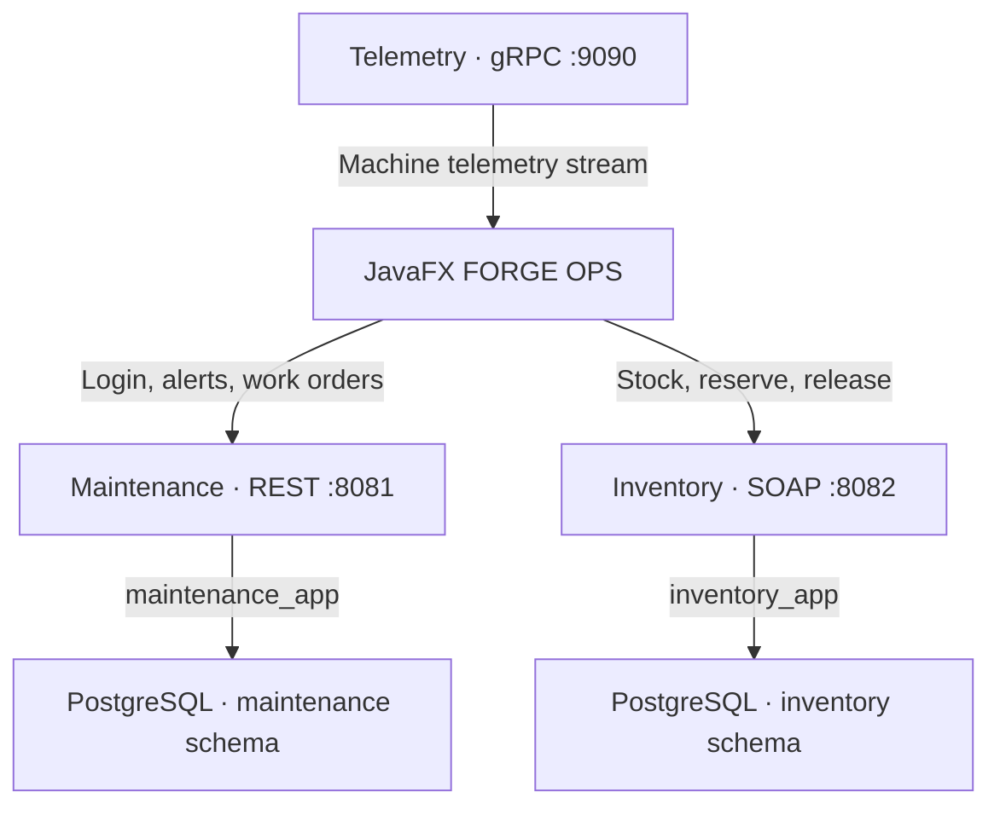

# Kestrel · Jury rehearsal

## Architecture



Both schemas reside in one local PostgreSQL instance. Each service connects with its own database role. Maintenance alone signs JWTs. Inventory and Telemetry verify the access token with its public key. The desktop uses UUIDs for REST resources and `machineCode` for gRPC telemetry and alert deduplication. Alert and work-order DTOs carry both identifiers.

## Startup

Use the checkout with Phases 0–8 applied, JDK 21, Python 3.9+, and Docker with Compose. Install `grpcurl` for the live check. Keep the existing `.env`, database volume, and signing keys. The Fedora database port in your existing `.env` is `55432` and Compose publishes it on loopback.

Use one `all` launcher for a normal demo. For the Inventory or Maintenance outage, run `prepare` once, then open one terminal for each service and the desktop. Run every command from the checkout root.

| Step | Fedora | Windows PowerShell |
|---|---|---|
| Build, keys, PostgreSQL | `./scripts/run-all.sh prepare` | `powershell.exe -NoProfile -ExecutionPolicy Bypass -File .\scripts\run-all.ps1 prepare` |
| Terminal 1 | `./scripts/run-all.sh maintenance` | `powershell.exe -NoProfile -ExecutionPolicy Bypass -File .\scripts\run-all.ps1 maintenance` |
| Terminal 2 | `./scripts/run-all.sh inventory` | `powershell.exe -NoProfile -ExecutionPolicy Bypass -File .\scripts\run-all.ps1 inventory` |
| Terminal 3 | `./scripts/run-all.sh telemetry` | `powershell.exe -NoProfile -ExecutionPolicy Bypass -File .\scripts\run-all.ps1 telemetry` |
| Terminal 4 | `./scripts/run-all.sh desktop` | `powershell.exe -NoProfile -ExecutionPolicy Bypass -File .\scripts\run-all.ps1 desktop` |

The combined launcher expects all three service ports to be free. `Ctrl+C` stops its service processes and leaves PostgreSQL running. `docker compose stop postgres` stops the database and keeps its volume.

## Automated checks

```bash
./scripts/phase9-smoke-test.sh
./scripts/phase9-smoke-test.sh --live --machine-code MACHINE-001
```

```powershell
powershell.exe -NoProfile -ExecutionPolicy Bypass -File .\scripts\phase9-smoke-test.ps1
powershell.exe -NoProfile -ExecutionPolicy Bypass -File .\scripts\phase9-smoke-test.ps1 --live --machine-code MACHINE-001
```

The first command enables the optional Maintenance and Inventory integration tests against disposable Testcontainers databases, runs the existing gRPC tests and unit tests, and executes the desktop freshness smoke class. Start Docker first for that mode. Look for `PASS. Maven reactor, isolated database tests, and desktop freshness.`

Run the live command with the backend up, a registered and online simulator machine, and at least one unit of the demo bearing. Enter the existing Maintenance admin password at the hidden prompt. The test uses a real gRPC snapshot, matches its code in REST, and creates one manual REST work order so that repeated runs coexist with production-style alert deduplication. It checks that reserve replay returns the same UUID, that stock falls once, that the REST link can be replayed, and that release restores stock once. It leaves a cancelled test work order and the associated audit and released-reservation records. Use a local demo database and avoid other changes to the bearing while the stock assertions run. If recovery fails, the test prints the relevant UUIDs. Look for `PASS. Live REST, SOAP and gRPC verification.`

## Six-minute presentation

| Time | Operator action | Evidence to show |
|---|---|---|
| 0:00–0:45 | Sign in and open Command Deck. | Selected registered machine, three protocol indicators, telemetry freshness. |
| 0:45–1:15 | Set the machine to NORMAL and open Live Telemetry. | New samples advance through the gRPC stream. |
| 1:15–2:30 | Arm Orchestration for one in-stock bearing. Trigger HIGH_TEMPERATURE. | An alert and work order appear in REST. SOAP confirms one reservation and REST reaches READY_FOR_MAINTENANCE. |
| 2:30–3:30 | Use a separate registered machine or resolve the prior open temperature alert. Arm for the zero-stock sensor and trigger HIGH_TEMPERATURE. | WAITING_FOR_PARTS with no reservation UUID. |
| 3:30–5:00 | Stop the Inventory JVM. Arm a fresh bearing run and trigger HIGH_TEMPERATURE. Restart Inventory and select Continue / retry saved step. | PENDING_RESERVATION is visible in Work Orders. Recovery links one SOAP-confirmed reservation. |
| 5:00–6:00 | Show the architecture and report the actual test results. | Explain the difference between machine code, work-order UUID, and reservation request UUID. |

The bearing UUID is `00000000-0000-4000-8000-000000000101`. The demo sensor UUID is `00000000-0000-4000-8000-000000000103`. Check stock before presenting. Return the scenario to NORMAL between runs. For the optional REST-failure demo, enable Pause after SOAP confirmation, stop Maintenance, then restart it and continue. Show the same reservation UUID before and after recovery.

## Jury Q&A

**Why three protocols?** REST provides resource operations and a state machine. SOAP provides a typed inventory contract and business faults. gRPC provides an open server stream for continuous telemetry.

**Which service decides a work-order transition?** Maintenance validates it. The desktop orchestrates API calls and renders the status returned by Maintenance.

**Why use a request UUID and a reservation UUID?** The request UUID identifies a reservation attempt and makes retry safe. Inventory assigns the reservation UUID to the persisted reservation. Maintenance stores that UUID after SOAP confirms the reservation.

**Can authentication or network availability be inferred from telemetry freshness?** The desktop tracks reading age independently. A connected stream can carry no new data while a machine is offline.

**How do the tests differ?** Unit checks exercise business rules. Integration tests run service endpoints against isolated resources. The live check exercises actual protocol responses and shared business IDs. The UI rehearsal demonstrates alert detection and intentional outages.

**Why one PostgreSQL instance?** It keeps deployment small for the demo. Separate schemas and application roles enforce service ownership. Service communication uses REST, SOAP, and gRPC.
