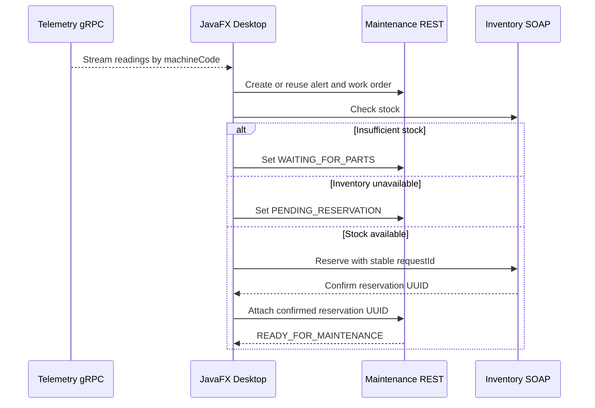

# Kestrel · Final rehearsal and desktop packaging

## Build the app image

The app image packages the JavaFX desktop client and a Java 21 runtime. Keep the entire generated `Kestrel` directory together when copying it. Build once on each target OS and CPU architecture. Start PostgreSQL and the three backends separately from the Kestrel repository.

Use a full JDK 21 with `jpackage` and `jmods`, plus Python 3.9+ and the existing Maven Wrapper. On Fedora, the JavaFX GUI needs the same GTK libraries as development mode. On Windows, run the Windows PowerShell commands with a Windows JDK.

| Action | Fedora Bash | Windows PowerShell |
|---|---|---|
| Apply UI polish | `python3 -B scripts/apply-desktop-polish.py` | `py -3 -B scripts/apply-desktop-polish.py` |
| Build and self-check | `./scripts/package-desktop.sh` | `powershell.exe -NoProfile -ExecutionPolicy Bypass -File .\scripts\package-desktop.ps1` |
| Start services only | `./scripts/run-all.sh backend` | `powershell.exe -NoProfile -ExecutionPolicy Bypass -File .\scripts\run-all.ps1 backend` |
| Run the automated suite | `./scripts/phase9-smoke-test.sh` | `powershell.exe -NoProfile -ExecutionPolicy Bypass -File .\scripts\phase9-smoke-test.ps1` |

Run the commands from the repository root. Substitute `python` for `py -3` if your Windows installation exposes only `python.exe`. The packager prints the exact `Launch:` path under `target/distribution/`. Run that launcher in a graphical desktop session.

Before starting the packaged client, wait for the backend startup checks. It connects to the same endpoints as the Maven-run client. To rehearse Inventory or Maintenance outages, use the four-terminal setup in [the Phase 9 demo guide](kestrel-demo.md) and launch the app image in the desktop terminal. Your existing `.env`, keys, and database volume stay in the backend checkout.

The automated image check loads the desktop entry point, JavaFX, gRPC stubs, Jackson, the Java HTTP client, and the FORGE OPS stylesheet. Launch the image and sign in to check JavaFX natives, GTK or Windows graphics, and the live service connections.

## Workflow sequence

When a reserve response is uncertain, replay the same SOAP `requestId`. When SOAP has confirmed and only the REST link is pending, continue linking with the saved reservation UUID. The [architecture diagram](kestrel-demo.md#architecture) shows ownership and protocol boundaries.

## Five-minute jury walkthrough

Before you start the timer, open the packaged desktop, sign in with the demo admin account and confirm that all three protocol indicators are reachable. In Maintenance, register simulator codes before using them. Use a separate machine per run when possible, or resolve the previous temperature alert first to start a fresh work order. Check that the bearing has at least two units available. Leave terminals for Maintenance and Inventory visible and ready to restart.

| Time | What to do | What to say |
|---|---|---|
| 0:00–0:50 | **A. Normal.** Select `MACHINE-001` on Command Deck. Open **Live Telemetry**. | “The gRPC stream updates live. The code selects the machine. REST resources use UUIDs.” |
| 0:50–2:00 | **B. Critical.** On **Orchestration**, arm a run for one bearing. In **Settings**, set the same machine to `HIGH_TEMPERATURE`. Show the work order when it reaches `READY_FOR_MAINTENANCE`. | “Maintenance records the alert and work order. Inventory confirms the reservation before Maintenance attaches its UUID.” |
| 2:00–3:00 | **C. Stock shortage.** Start a fresh run for one sensor. Trigger high temperature and open **Work Orders**. | “The stock check confirms a shortage. The order stays at `WAITING_FOR_PARTS` with no reservation UUID.” |
| 3:00–4:25 | **D. Inventory outage.** Stop Inventory in its terminal. Trigger a fresh bearing run. Show `PENDING_RESERVATION`, restart Inventory, then select **Continue / retry saved step**. | “The inventory outcome is pending. Retrying reuses the same request UUID if a reserve call was already attempted.” |
| 4:25–5:00 | Show the architecture and terminal test summary. Set the simulator back to `NORMAL`. | “Three protocols address three integration needs. Service roles control schema access, and the client coordinates work through the published contracts.” |

- Bearing UUID `00000000-0000-4000-8000-000000000101`
- Zero-stock sensor UUID `00000000-0000-4000-8000-000000000103`

## Final acceptance checklist

- [ ] The Maven reactor, isolated PostgreSQL integration tests, gRPC tests and desktop freshness check pass.
- [ ] The live Phase 9 test matches the simulator code to a REST machine and confirms one stock deduction and restoration across SOAP replays.
- [ ] The packaged desktop launches. Sign-in, the protocol indicators, the theme, and Live Telemetry all work.
- [ ] Opening a screen uses a brief entrance with default motion. Enable **Reduce motion** in Settings and repeat navigation. The screen appears immediately.
- [ ] An empty list displays an empty-state message. Stop a service from its dedicated terminal and check that the relevant screen retains a readable failure status. Restore the service and refresh.
- [ ] Pause the simulator and verify that the last chart values are marked stale or offline. Restore `NORMAL` and verify that new readings return it to live.
- [ ] Rehearse A through D in five minutes. As a backup demonstration, pause after SOAP confirmation, restart Maintenance, and show that the original reservation UUID is linked on retry.
- [ ] Verify `.env` and `.kestrel/keys` are ignored. Check that the distributable folder contains only the client image.
- [ ] Record the OS and CPU architecture for every app image you hand over, and record which startup and demo checks passed on each.

## Jury questions

**Why a JavaFX client and an app image?** JavaFX renders continuous telemetry and provides a single place to operate the three protocols. The app image bundles the Java runtime and client dependencies for its target platform.

**Why can the client recover without a distributed transaction?** Inventory commits reservation and stock changes together. Maintenance records its own work-order state. The client persists stable identifiers for retrying either the reservation or the link after an outage.

**What protects the service boundaries?** Maintenance signs the session JWT. Each service validates it and checks the applicable role. The database roles give each persistence service access to its own schema.

**What does a green smoke test prove?** The integration tests exercise the contracts and expected service behavior. The live test checks cross-service IDs and replay behavior. The visual rehearsal checks the full alert-driven flow, freshness cues, and operator recovery.
